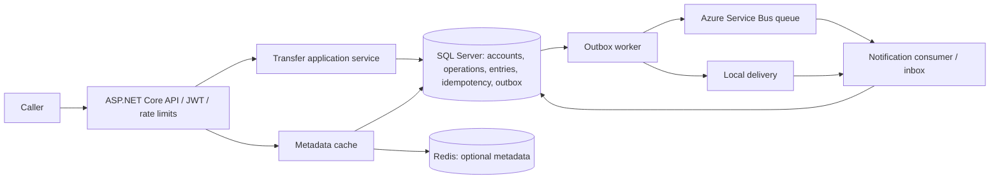

# LedgerFlow

A transaction-processing backend for **synthetic data**, built with ASP.NET Core, EF Core, SQL Server, Redis and an Azure Service Bus adapter. It demonstrates atomic transfers, durable idempotency, concurrent spending protection, a double-entry ledger and asynchronous notifications. This is a personal engineering demonstration, not a banking service or regulated financial product.

## Quick start

Prerequisites: Docker Engine with Compose v2, OpenSSL, and at least 4 GB available memory (SQL Server requires x86-64). Python 3 is needed only for the smoke check. Do not expose the development instance publicly.

```sh
./scripts/dev-init.sh       # creates an ignored .env with a random local SQL password
# Review Microsoft's SQL Server Developer Edition license before running.
docker compose up --build
```

Compose waits for SQL, runs the checked-in EF migrations using a one-shot container, and starts the API on port 8080. Redis is included. SQL data survives restarts in a named volume. Ordinary startup never drops data. Swagger UI is at `/swagger`, OpenAPI JSON at `/swagger/v1/swagger.json`.

In another terminal:

```sh
python3 scripts/smoke.py
```

This creates synthetic accounts, posts development funding and a transfer, retries it, and verifies balances and history. Local transport is selected; no Azure subscription is required. Stop services with `docker compose down`. Changing the generated password does **not** change the password in an existing SQL volume; preserve `.env` with your local data.

### Run the API outside Docker

Install the SDK pinned in `global.json`. From the checkout root:

```sh
./scripts/dev-init.sh
docker compose up -d --wait sql redis
set -a; . ./.env; set +a
export ConnectionStrings__Sql="Server=localhost,1433;Database=LedgerFlow;User Id=sa;Password=$SQL_PASSWORD;Encrypt=True;TrustServerCertificate=True"
export ASPNETCORE_ENVIRONMENT=Development Auth__Development=true Redis=localhost:6379
export ASPNETCORE_URLS=http://localhost:8080
dotnet restore --locked-mode
dotnet tool restore
dotnet run --project src/LedgerFlow -- --migrate
dotnet run --project src/LedgerFlow
```

Development SQL uses a self-signed certificate and SA for convenience. For a deployed configuration use a trusted SQL certificate, a least-privilege runtime principal, a separate migration principal, and an external identity provider. Never copy development trust/authentication settings into a public deployment. No cloud resources are provisioned by this project.

## Architecture



The modular monolith keeps `Domain` records, the `Application` transfer use case, `Infrastructure` persistence/transports/cache, and API composition in one executable. There is no generic repository or distributed transaction. SQL transactions are the consistency boundary.

## Ownership and authentication

Accounts belong to the validated JWT `sub` claim; subjects and idempotency keys are case sensitive. Tokens must contain a nonempty subject up to 200 characters, with no control characters or surrounding whitespace (avoiding SQL padded-string equality ambiguities). Callers can list/read/fund only their own accounts and debit only their own accounts. Transfers may credit another caller's account by known ID. Unavailable or inaccessible accounts return 404 to avoid distinguishing ownership. There is no public account directory. Notifications expose only operations involving a caller's accounts.

Outside Development, configure `Auth__Authority` and `Auth__Audience` for an HTTPS OIDC/JWT issuer. Signature, issuer, audience and expiry validation are enabled. Without an authority, startup fails. No signing key or password is checked in.

Only with **both** `ASPNETCORE_ENVIRONMENT=Development` and `Auth__Development=true` does `POST /dev/token/{subject}` issue synthetic tokens. Its signing key is random in process memory and rotates on restart. Anyone reaching that development endpoint can impersonate a synthetic subject, so it is unsuitable for shared/public environments. The funding endpoint exists only in Development, requires authentication, and never exists in Production. There are no default production credentials. Compose binds ports to loopback.

## API examples

See [requests.http](requests.http). Obtain a development token and set it as a Bearer token in your client; the token is not persisted by scripts.

| Endpoint | Purpose |
|---|---|
| `POST /dev/token/alice` | Development-only synthetic token, when explicitly enabled |
| `POST /api/accounts` | Create a zero-balance account: `{"currency":"USD"}` |
| `GET /api/accounts?page=1&size=20` | Owned accounts, ordered by ID |
| `GET /api/accounts/{id}` | Owned account metadata (cache eligible) |
| `GET /api/accounts/{id}/balance` | Authoritative SQL balance |
| `POST /api/dev/accounts/{id}/fund` | Development-only funding: `{"amount":10000}` |
| `POST /api/transfers` | `{"from":"<guid>","to":"<guid>","amount":2500}` plus `Idempotency-Key` |
| `GET /api/accounts/{id}/history` | Posted transfers and funding involving this account |
| `GET /api/notifications` | Durable notification receipts involving owned accounts |
| `GET /health/live`, `GET /health/ready` | Process liveness and SQL schema readiness |

Amounts are signed 64-bit **integer minor units**; transfer requests must be positive and at most 1,000,000,000,000. USD, INR and EUR are supported with exactly two decimal places: `2500` means 25.00. No floats, decimals in request amounts, rounding, FX conversion or cross-currency transfers are accepted. Account creation validates currency. Closed source or destination accounts reject transfers with 409; closure administration is intentionally absent from the public API.

Unknown JSON properties are rejected rather than silently accepted. Errors use Problem Details (`application/problem+json`), with 400 for invalid input, 401/403 for authentication/claim failure, 404 for inaccessible accounts, 409 for business or key conflicts, 429 for rate limiting, and 503 for SQL failures. Unknown server errors return a generic 500, not exception details. No request bodies or access tokens are logged.

History accepts `page` (1..100000), `size` (1..100), inclusive `from`, exclusive `to` (ISO UTC timestamps), and `kind` (`Transfer` or `DevelopmentFunding`). Ordering is `CreatedAt DESC, Id DESC`, including timestamp ties. Offset pages are deterministic for a fixed dataset; for a long export freeze an upper `to` bound. Concurrent inserts can shift offset pages; snapshot exports/keyset pagination are future work.

## Data and consistency

| Record | Role |
|---|---|
| Account | Owner, currency, closed flag, materialized balance in minor units |
| Operation | Stable GUID, kind, source/destination, amount, currency, UTC posting time |
| Entry | Signed delta against one account, linked to an operation |
| Idempotency | Composite `(Caller, Key)` primary key, fingerprint, status and replay JSON |
| Outbox | Stable event GUID, versioned payload, attempts, next attempt, published time, error type |
| Notification | Inbox/receipt keyed by event GUID, transfer ID and received time |

The immutable ledger entries are the accounting history. Each operation has exactly two entries, debit `-amount` and credit `+amount`, summing to zero. Account balance is the materialized sum of its entries and is updated in the same transaction. APIs never update/delete posted operations or entries. This invariant is maintained by application write paths and integration tests; direct SQL writes must be restricted operationally. SQL enforces entry foreign keys, unique `(AccountId, OperationId)`, idempotency/inbox primary keys, and nonnegative balances for ordinary accounts.

New accounts start at zero. Development funding posts a `DevelopmentFunding` operation with a debit against a per-currency internal `__funding__` synthetic clearing account (allowed to be negative) and a matching credit to the target. It does not silently edit balances. Internal clearing accounts cannot be transfer recipients and cannot authenticate. Funding is deliberately non-idempotent; each call creates a new synthetic funding operation. It is rate limited, capped at 1,000,000,000 minor units per call, and not a deposit API. There is no automatic seed on startup; the smoke script is the explicit development seed.

### Transfer transaction and concurrency

1. Begin a SQL Server transaction at Read Committed.
2. Acquire a transaction-owned exclusive `sp_getapplock` for the SHA-256 of caller + key (5-second wait).
3. Replay an existing idempotency result or reject a different fingerprint.
4. Acquire transaction-owned exclusive account application locks, sorted by GUID using the same ordering in all transfer writers.
5. Read accounts **after** obtaining locks; validate ownership, availability, currency, funds and destination overflow.
6. Write balances, operation, two entries, outbox event and idempotency result; commit once.

Application locks serialize competing writers across API processes, not just threads. Development funding uses its own global funding lock and the same target account lock. Read paths never authorize spending. A check constraint provides an additional guard against negative ordinary balances. Bypassing these write paths with manual SQL can violate accounting invariants; this is not a database permission boundary against a malicious DBA.

Deadlock victims retry the **entire** transaction with a new context, at most three retries with short exponential jitter. SQL application-lock deadlocks are distinguished from lock timeouts. Timeouts/connection failures return 503; the client retries with the **same** key. EF execution-strategy retries are intentionally not layered over this transaction. A lost commit acknowledgement is resolved by the durable key on retry. Transaction rollback leaves no partial transfer or idempotency record. See [ADR 001](docs/adr/001-sql-consistency.md).

### Idempotency contract

`Idempotency-Key` is mandatory for transfers, 1..128 printable non-space ASCII characters, scoped to the caller. The fingerprint is SHA-256 of a canonical serialization of typed source, destination and integer amount. Equivalent JSON whitespace/property ordering does not change it. The SQL primary key is the final uniqueness guard; Redis is never involved.

Identical retries return the saved status and JSON, including the original transfer ID/time. Different payloads return 409. Concurrent requests wait on the same database lock, then replay; if the bounded wait expires the response is 503 and the caller retries. Business/shape validation results reached inside the service (400/404/409) are retained too: correcting a failed request requires a new key. Authentication, malformed JSON, missing keys and rate-limit failures occur before the transaction and are not retained. Transient database failures roll back, leaving the key reusable. Keys are retained indefinitely in this demonstration; there is no expiry job that could silently allow a duplicate transfer. Storage/archival policy is future work.

## Outbox and notifications

`ledgerflow.transfer-posted.v1` carries an event GUID, schema version `1`, transfer ID, account IDs, amount/currency and UTC time. The event and transfer commit atomically. The worker locks the dispatcher across instances, publishes up to 20 rows, and records acknowledgements. It uses a 10-second publish timeout and exponential retry delays capped at 300 seconds, with a terminal state after 10 failed attempts. `LastError` stores the exception type without potentially sensitive broker details. Terminal rows remain inspectable and are not silently discarded.

Delivery is **at least once**, with possible duplicates if publication succeeds but recording the acknowledgement fails. Each consumer transaction locks its inbox event ID and inserts the notification once; concurrent redelivery cannot duplicate it. Service Bus `MessageId` equals the event GUID, but correctness does not depend on broker duplicate detection. Ordering across transfers is not guaranteed. The dispatcher holds a SQL transaction during a small bounded publish batch: simple for a demo, but a leased dispatcher would scale better. See [ADR 002](docs/adr/002-outbox.md).

Default `Transport=Local` invokes the same durable notification consumer directly. It models publication failure/redelivery tests but **does not validate Azure connectivity, AMQP delivery or broker behavior**. With `Transport=Azure`, configure `ServiceBus__ConnectionString` securely and `ServiceBus__Queue` for an existing queue. The adapter uses the official Azure SDK; a hosted receiver consumes from that queue, persists its inbox/notification, then explicitly completes the broker message. Broker retry and dead-letter settings belong to the queue. No Azure namespace/queue is created, and no paid infrastructure is deployed. Use a dedicated queue for live tests; never put connection strings in tracked files.

## Redis

Only immutable account metadata is cached, under `ledgerflow:metadata:v1:{owner}:{accountId}` for 60 seconds. Creation has no prior cached entry. Transfers change balances only, so there is no balance invalidation race. There is no metadata mutation API; future close/rename features must invalidate these keys. If operators change metadata directly, invalidate the matching key or allow the TTL to expire. Cache errors/timeouts fall back to an ownership-filtered SQL query. Balances, sufficient funds, ownership checks on writes, idempotency and the ledger never depend on Redis. Readiness intentionally remains healthy during a Redis outage. See [ADR 003](docs/adr/003-cache-auth.md).

## Tests and CI

```sh
dotnet restore --locked-mode
dotnet build --no-restore
dotnet test --no-restore             # unit tests; SQL tests explicitly skip without a connection
./scripts/test.sh                   # starts SQL + Redis and executes real SQL integration tests
```

Alternatively, set `LEDGERFLOW_TEST_SQL` securely to a dedicated disposable SQL Server database, then run `dotnet test`. The suite applies migrations and creates unique synthetic fixtures. It never deletes an existing database. The rollback test briefly creates a deliberately failing trigger; **never point this suite at a shared or production database**. SQL tests exercise transfer success, failure validation, authorization, balanced entries, idempotency replay/conflicts, parallel duplicate keys, parallel spending, rollback, outbox retry, duplicate consumption, cache outage fallback and history pagination. No SQLite or EF in-memory provider is used.

GitHub Actions restores locked packages, builds, starts SQL/Redis, runs the SQL tests, builds/starts Compose and exercises the HTTP smoke workflow. CI configuration in the repository does not establish that a remote CI run passed; inspect its run results. The live adapter roundtrip test requires `LEDGERFLOW_TEST_SERVICEBUS` and `LEDGERFLOW_TEST_QUEUE` supplied securely. Use an empty, dedicated queue with no competing receiver; the test sends and consumes a synthetic message and validates the real adapter contract. It is explicitly skipped without those settings and is not part of the default test job.

## Configuration and operations

| Setting | Meaning / default |
|---|---|
| `ConnectionStrings__Sql` | Required SQL Server connection string; provide securely |
| `Redis` | Redis endpoint; default `localhost:6379`; connect/async timeouts 500 ms |
| `Transport` | `Local` (default) or `Azure` |
| `ServiceBus__ConnectionString` | Azure transport/receiver credential; no checked-in default |
| `ServiceBus__Queue` | Existing queue; default `transfers` |
| `Auth__Authority`, `Auth__Audience` | External HTTPS JWT issuer/audience outside explicit development auth |
| `Auth__Development` | Default false; effective only in Development |
| `RateLimit__PerMinute` | Fixed-window write limit per authenticated subject, default 60; token endpoint partitions by IP |
| `ASPNETCORE_ENVIRONMENT` | Production by default; Compose explicitly uses Development |
| `ASPNETCORE_URLS` | Listening addresses outside Docker; container listens on 8080 |

SQL command timeout is 15 seconds, application lock wait 5 seconds, outbox polling 1 second. `Outbox__PublishTimeoutSeconds` (1..60, default 10), `Outbox__MaxAttempts` (1..100, default 10), `Outbox__PollMilliseconds` (100..60000, default 1000), and `Sql__CommandTimeoutSeconds` (1..120, default 15) configure operational bounds. The Service Bus SDK also applies its own bounded retry policy. API cancellation tokens flow into EF and SQL lock commands. Worker shutdown cancels waits/publication and rolls back uncommitted work; the next instance can retry committed pending events.

JSON console logs include request correlation scopes. `X-Correlation-ID` returns the server-generated request identifier; framework distributed traces retain W3C trace context. Successful publication logs stable event IDs. Problem Details for server exceptions include a trace ID. The `LedgerFlow` `System.Diagnostics.Metrics` meter exposes `ledgerflow.transfer.outcomes` (status dimension), `ledgerflow.outbox.published` and `ledgerflow.outbox.failures`; collect them with .NET diagnostics/OpenTelemetry tooling as needed. No metrics scraping server is bundled.

`/health/live` is process-only. `/health/ready` queries the SQL schema, returning 503 when unavailable. Redis is optional and broker outages accumulate outbox rows without preventing SQL commits. Inspect backlogs with read-only SQL:

```sql
SELECT Id, CreatedAt, Attempts, NextAttempt, LastError
FROM Outbox WHERE PublishedAt IS NULL ORDER BY CreatedAt, Id;
-- Reconcile materialized balances against all ledger entries:
SELECT a.Id, a.Balance, COALESCE(SUM(e.Amount), 0) AS LedgerBalance
FROM Accounts a LEFT JOIN Entries e ON a.Id=e.AccountId
GROUP BY a.Id,a.Balance HAVING a.Balance <> COALESCE(SUM(e.Amount),0);
```

After diagnosing a terminal event and restoring the broker, an operator can deliberately reset that row's attempts and next-attempt time through controlled SQL. Preserve its event ID so inbox deduplication still works. Do not delete ledger entries or rerun a transfer to repair publication.

## Limitations and future work

No reversals, interest, FX, settlement, payment integrations or regulatory controls. No production security review, benchmark or availability claim. Rate limits are per API instance. Database/application credentials must be managed externally. No automatic outbox archival, inbox retention, lease partitioning, keyset exports, tracing collector or disaster-recovery automation. Account closure administration and ledger tamper-evidence are future work. A real Service Bus environment must be tested independently before claiming Azure delivery works.
